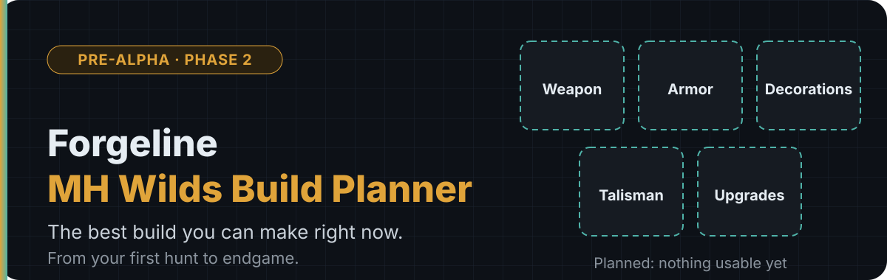
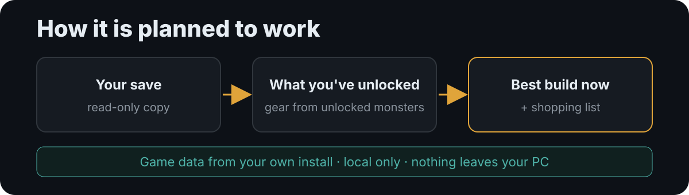

  

  
  
  
  
  
  

A planned Windows and Steam desktop app that reads your Monster Hunter Wilds save and shows the **best build you can make right now**: weapon, armor, decorations, talisman and upgrades. It is meant to follow you through low rank, high rank and endgame.

> **Status: pre-alpha. Nothing is usable yet.** Phase 1 (spikes) is done: research and throwaway experiments settled the architecture (pure-Rust egui UI, MPL-2.0 licence, save and game-pack reading proven). Phase 2 (foundation) is in progress, plan in [docs/plans/phase-2-foundation.md](docs/plans/phase-2-foundation.md). There is no release, no installer and no working app. Everything below describes the plan, and every feature is **planned** unless stated otherwise.

## What it will do (planned)

  

- Read your save automatically and pick the active character slot.
- Show the best build you can make with the gear you have unlocked. It never shows a "wait until endgame" build.
- Cover low rank and high rank, and recompute when your save changes.
- Treat gear from monsters you have unlocked as available, and put missing materials on a shopping list.
- Offer playstyle presets (solo, multiplayer, safe), a per-monster mode, and alternatives next to the best build (safe, defensive, monster-specific, general hunting, Gogma-specific).
- Treat must-have skills as hard constraints, calculate damage, and weigh comfort and defence skills with weights you can edit.
- Plan Artian and Gogma Artian weapons (later phase).
- Show its assumptions (uptime, weak-spot rate, weights) and flag when the best build changes within a plausible range of them. Modelled numbers are never presented as measured.

**Weapons:** the light bowgun comes first. Every weapon is to be optimized before 1.0.0, one at a time, and the app will label each weapon as either tuned or generic.

**Out of scope** unless reopened: a rotation simulator and a fight model.

## Principles

- **Read-only on the game.** The app never writes to, moves or deletes your save files, the game install or your Steam folders. It works on copies of the save.
- **No injection.** It never injects into, hooks or reads the memory of the running game.
- **Local only.** No network listener, no telemetry, no accounts. Nothing leaves your machine.
- **Light while Wilds runs.** Low idle CPU, memory and GPU, no polling when nothing has changed, and heavy work runs only when you trigger it, off the UI thread at low priority. See the [performance budget](docs/performance-budget.md).
- **Fast.** It should open quickly and show the last build from cached data straight away.
- **Data from your own install.** Game data is extracted from your own copy of the game when you press the update button. It never auto-fetches. A new extraction is checked against the last good data before it replaces it, and if anything fails the app keeps the old data and says so.
- **No Capcom data shipped.** Extracted game data, saves and decrypted dumps stay out of this repository and out of any release package.
- **Honest about gaps.** Game facts come from extracted data or a cited source. Anything unverified is marked as such.

## Platform and stack

- Windows and Steam only.
- Written in Rust, including our own tools.
- The UI is pure Rust with egui, chosen in Phase 1 because it met the performance budget with Wilds running while Tauri and Electron did not.
- The game install is found through Steam's library list, and the Steam ID comes from the save folder name.

## Roadmap

The full plan is in [docs/PLAN.md](docs/PLAN.md). Each phase gets its own detailed plan in `docs/plans/`, approved before work starts.

1. **Spikes** (done, 0.1.0): type data, save ID matching, licence review, extraction test, UI comparison.
2. Foundation (in progress, target 0.2.0): save and install discovery, save reader, file watcher, extractor and update button, debug data viewer.
3. Data and progression: data model for every weapon, unlock logic.
4. Light bowgun optimizer.
5. Calibration.
6. Interface and shopping list.
7. Farming routes, decorations and melding.
8. Artian and Gogma Artian planner.

After that: the other weapons, then packaging for Nexus Mods.

## Repository layout

| Path | Contents |
|------|----------|
| [`CLAUDE.md`](CLAUDE.md) | Standing project rules |
| [`docs/PLAN.md`](docs/PLAN.md) | Overall plan and verified findings |
| [`docs/plans/`](docs/plans/) | Per-phase plans and the [template](docs/plans/TEMPLATE.md); [Phase 1](docs/plans/phase-1-spikes.md) (closed), [Phase 2](docs/plans/phase-2-foundation.md) (in progress) |
| [`docs/performance-budget.md`](docs/performance-budget.md) | Start-up, memory, CPU and recompute targets |
| [`docs/research.md`](docs/research.md) | Spike and research results |
| [`docs/open-questions.md`](docs/open-questions.md) | Unanswered questions |
| [`docs/closed-questions.md`](docs/closed-questions.md) | Answered questions |
| [`CONTRIBUTING.md`](CONTRIBUTING.md), [`SECURITY.md`](SECURITY.md), [`CODE_OF_CONDUCT.md`](CODE_OF_CONDUCT.md) | How to contribute, report problems privately, and behave |

There is no application code on the main branch yet. Phase 1 spike code is kept for reference on the `spikes-archive` branch and is not merged.

## Contributing

The project is at an early stage; see [CONTRIBUTING.md](CONTRIBUTING.md). Basics that already apply:

- **Bring your own save.** Anyone working on the project uses their own local saves.
- **Never commit** saves, decrypted save dumps (they contain hunter IDs), extracted Capcom data, tokens, keys or other personal data.
- Automated tests use small fixture saves and fixture data. They must pass on a machine without Wilds and never touch a real save, a real install or the live MHDB API.
- Work happens on a branch and goes in through a pull request. The default branch is `main`.
- Third-party code needs its licence recorded in `THIRD-PARTY-NOTICES.md` before it enters the repo. Code from projects without a licence is not used.
- Please read [CLAUDE.md](CLAUDE.md) and [docs/PLAN.md](docs/PLAN.md) first.

## Versioning

Semantic versioning. 1.0.0 is the full release, a major addition bumps the minor number (x.1.x), and a bug fix bumps the patch number (x.x.1). A changelog starts from Phase 2.

## Licence

Forgeline's own code is under the [Mozilla Public License 2.0](LICENSE) (MPL-2.0). In plain words, and not legal advice:

- You can use it, change it and fork it, and send changes back.
- Forks are welcome, including republishing, as long as they credit **"based on Forgeline"**, keep the copyright notices and licence, and do not present the fork as the official Forgeline.
- If you change a file that is under MPL-2.0 and share the result, share that file's source under MPL-2.0 too. You can add your own files under other terms.
- The licence covers our code only. It does not cover Capcom's game data, which is never in this repo, or the third-party code listed in [THIRD-PARTY-NOTICES.md](THIRD-PARTY-NOTICES.md).

Contributions are accepted under the same licence, with no extra paperwork.

## Support

Forgeline is free. If you want to, you can leave an optional tip on [Ko-fi](https://ko-fi.com/veroxaus). It is a tip with no perks: nothing is locked behind it, and every feature and update stays free. The tip link lives on this GitHub page only, not on the Nexus Mods page.

## How Forgeline is made

Forgeline is a human-directed project built with AI assistance. The maintainer (VeroxAUS):

- sets the direction and makes every product decision
- reviews and approves every phase plan before any work starts
- reviews every pull request, plan, document and code change before it merges
- runs every test round on their own PC with the real game, including benchmarks with Wilds running, and does the in-game testing
- decides every rule, licence and tool

Claude (Anthropic's AI) writes most of the code and documents under that direction. Game data and results are verified against the game, never filled in by the AI.

## Disclaimer

This is an unofficial fan project. It is not affiliated with or endorsed by Capcom or Valve. Monster Hunter Wilds is a trademark of Capcom.
